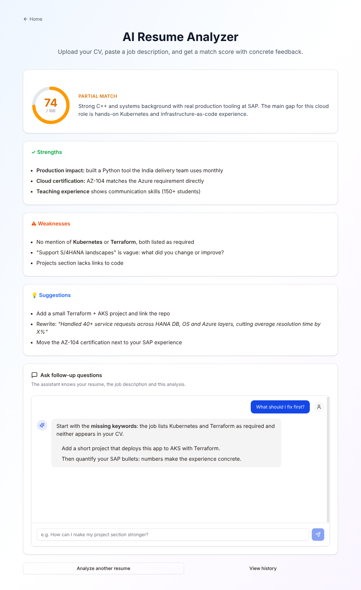

# AI Resume Analyzer

[](https://github.com/silviacioroiu/ai-resume-analyzer/actions/workflows/ci.yml)

Upload a CV (PDF or DOCX), paste a job description, and get:

- a **0–100 match score** for that role (or an overall quality score if no job is given),
- **strengths, weaknesses and concrete rewrite suggestions** from Google Gemini,
- an **AI chat** for follow-up questions, grounded in your resume, the job and the analysis,
- a **history** of past analyses per account.

Works with English and Romanian resumes.

> 🏆 **1st place, EESTEC Olympics Hackathon @ RSystems (2025).** The first version was built in a 6-hour hackathon
> together with my team ([original repo](https://github.com/MarioTimoc21/CVAnalyzer)). This repository continues
> the project: structured scoring, the follow-up chat, tests, CI/CD and a cleanup of the codebase.



<sub>Example output.</sub>

## Tech stack

| Layer    | Tools                                                                         |
| -------- | ----------------------------------------------------------------------------- |
| Frontend | React 19, TypeScript, Vite, Tailwind CSS, shadcn/ui, TanStack Query           |
| Backend  | Node.js, Express, tRPC, Zod                                                   |
| AI       | Google Gemini (`gemini-2.5-flash`) with JSON-schema structured output         |
| Data     | PostgreSQL + Drizzle ORM (migrations), MinIO (S3-compatible) for uploaded CVs |
| Auth     | JWT + bcrypt                                                                  |
| DevOps   | Docker multi-stage build, Docker Compose, GitHub Actions → GHCR               |

## How it works

```
Browser ──upload PDF/DOCX──► Express /api/upload-resume ──► text extraction (unpdf / mammoth)
   │                                      └──► original file stored in MinIO
   │
   ├──tRPC resume.analyze──► Gemini (responseSchema: score, summary, strengths, ...)
   │                          └──► validated with Zod, score clamped to 0–100, saved to PostgreSQL
   │
   └──tRPC resume.chat────► loads the saved analysis (owner-checked) as system context
                             └──► multi-turn Gemini chat
```

- **Structured output:** the analysis prompt defines a scoring rubric and sets Gemini's `responseSchema`, so the
  model returns typed JSON instead of free text. The server still validates it (`server/gemini.ts`).
- **Grounded chat:** the client sends only the conversation; the server loads the resume, job description and
  analysis from the database, so users can only chat about their own analyses.

## Running locally

### With Docker (everything included)

```bash
cp .env.example .env        # then set GEMINI_API_KEY and JWT_SECRET
docker compose up --build
```

Open http://localhost:3000. Migrations run automatically when the app container starts.

### App outside Docker (hot reload)

```bash
pnpm install
cp .env.example .env                       # set GEMINI_API_KEY and JWT_SECRET
docker compose up -d db minio minio-setup  # PostgreSQL + MinIO only
pnpm db:migrate
pnpm dev                                   # http://localhost:3000
```

You can get a free Gemini API key from [Google AI Studio](https://aistudio.google.com/app/apikey).

## Scripts

| Command            | What it does                                        |
| ------------------ | --------------------------------------------------- |
| `pnpm dev`         | Dev server with Vite HMR                            |
| `pnpm check`       | TypeScript type check                               |
| `pnpm test`        | Unit tests (Vitest)                                 |
| `pnpm build`       | Production build of client and server               |
| `pnpm db:generate` | Generate a migration after editing the schema       |
| `pnpm db:migrate`  | Apply migrations                                    |

## CI/CD

`.github/workflows/ci.yml` runs on every push and pull request:

1. type check, unit tests and production build;
2. on `main`, builds the Docker image (with layer caching) and publishes it to
   `ghcr.io/silviacioroiu/ai-resume-analyzer`.

## Project structure

```
client/src/       React app (pages: Home, Login, Analyzer, History)
server/           Express + tRPC API
  gemini.ts       prompts, Gemini calls, response validation
  routers.ts      tRPC procedures (analyze, list, get, chat)
  fileParser.ts   PDF/DOCX text extraction
  authRouter.ts   register / login / me
drizzle/          schema and SQL migrations
```

## License

MIT
